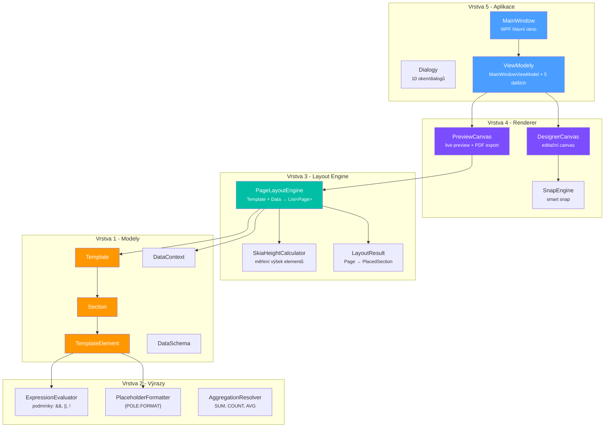
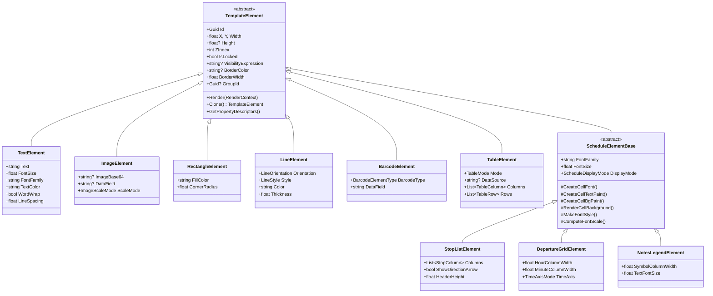
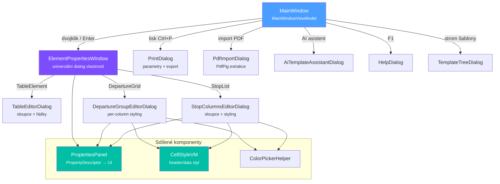
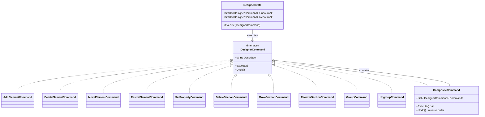
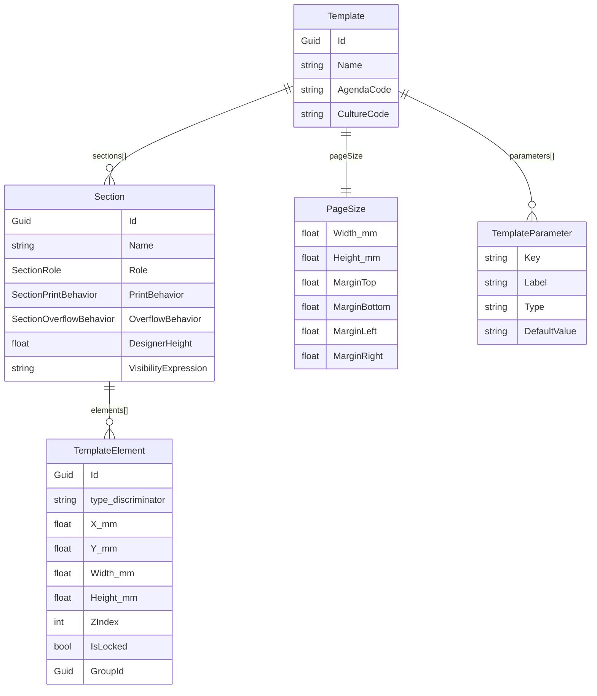
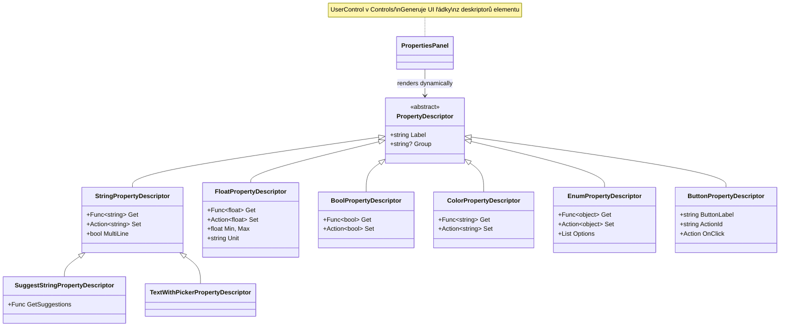
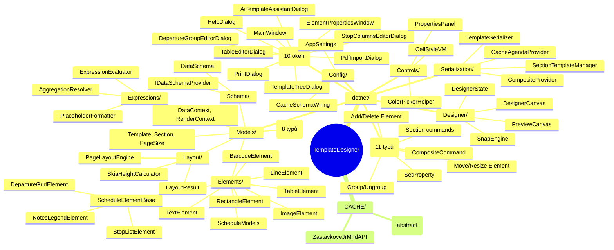

# Architektonické diagramy - TemplateDesigner

> **Konceptuální diagramy** (vrstvy, datový tok, hierarchie). Cenné pro onboarding a školení.
> Autoritativní zdroj struktury kódu je vždy `.claude/docs/architecture.md` + samotný kód - diagramy
> mohou mírně zaostávat za detaily. Při rozporu vyhrává kód/rules.

## 1. Vrstvy systému



---

## 2. Hierarchie elementů



---

## 3. Tiskový pipeline (data flow)

```mermaid
flowchart LR
    subgraph "Design Time"
        Designer["Designer<br/>šablona.json"]
        Mock["GetMockData()<br/>vzorová data"]
        Preview["PreviewCanvas<br/>live preview"]
    end

    subgraph "Print Time"
        Params["PrintDialog<br/>parametry tisku"]
        GetData["GetData()<br/>reálná data z Caché"]
    end

    subgraph "Engine"
        PLE["PageLayoutEngine"]
        SHC["SkiaHeightCalculator"]
        EE["ExpressionEvaluator"]
        PF["PlaceholderFormatter"]
    end

    subgraph "Output"
        Screen["WPF Canvas<br/>SKElement"]
        PDF["PDF soubor<br/>SkiaSharp"]
    end

    Designer --> |Template| PLE
    Mock --> |DataContext| Preview
    Preview --> |Template + Mock| PLE
    Params --> GetData
    GetData --> |DataContext[]| PLE
    PLE --> |měření| SHC
    PLE --> |LayoutResult| Screen
    PLE --> |LayoutResult| PDF
    EE -.-> |visibility filter| PLE
    PF -.-> |{POLE} → hodnota| PLE

    style Designer fill:#ff9800,color:#fff
    style PLE fill:#00bfa5,color:#fff
    style PDF fill:#e91e63,color:#fff
    style Screen fill:#4a9eff,color:#fff
```

---

## 4. Okna a dialogy



---

## 5. Undo/Redo command systém



---

## 6. Caché API a datové zdroje

```mermaid
flowchart TB
    subgraph "C# (.NET)"
        CSW["CacheSchemaWiring"]
        CAP["CacheAgendaProvider<br/><small>IDataSchemaProvider +<br/>ITableTemplateProvider</small>"]
        COMP["CompositeDataSchemaProvider<br/><small>Caché primary + JSON fallback</small>"]
        JSON["JsonFileDataSchemaProvider<br/><small>schemas/*.schema.json</small>"]
        MLR["MLRest / IMLRest<br/><small>HTTP klient → Caché</small>"]
    end

    subgraph "Caché (ObjectScript)"
        AA["AgendaAPI<br/><small>abstraktní základ</small>"]
        MHD["ZastavkoveJrMhdAPI<br/><small>6-fázový MHD engine</small>"]
    end

    subgraph "Caché DB (globály)"
        LSO["^ALVA.MHD.LSO<br/><small>linky, spoje, trasy</small>"]
        ZST["^ALVA.MHD.ZST<br/><small>zastávky</small>"]
        CHR["^ALVA.MHD.CHR<br/><small>chronometráže</small>"]
        ENUMS["^ALVA.MHD.ENUMS<br/><small>číselníky</small>"]
    end

    CSW --> CAP
    CAP --> MLR
    COMP --> CAP
    COMP --> JSON
    MLR --> |"HTTP CVar"| AA
    AA <|-- MHD
    MHD --> LSO
    MHD --> ZST
    MHD --> CHR
    MHD --> ENUMS

    style MLR fill:#e91e63,color:#fff
    style AA fill:#ff9800,color:#fff
    style MHD fill:#ff9800,color:#fff
    style LSO fill:#795548,color:#fff
    style ZST fill:#795548,color:#fff
    style CHR fill:#795548,color:#fff
    style ENUMS fill:#795548,color:#fff
```

---

## 7. Datový model šablony



---

## 8. PropertyDescriptor systém



---

## 9. Celkový přehled souborové struktury


